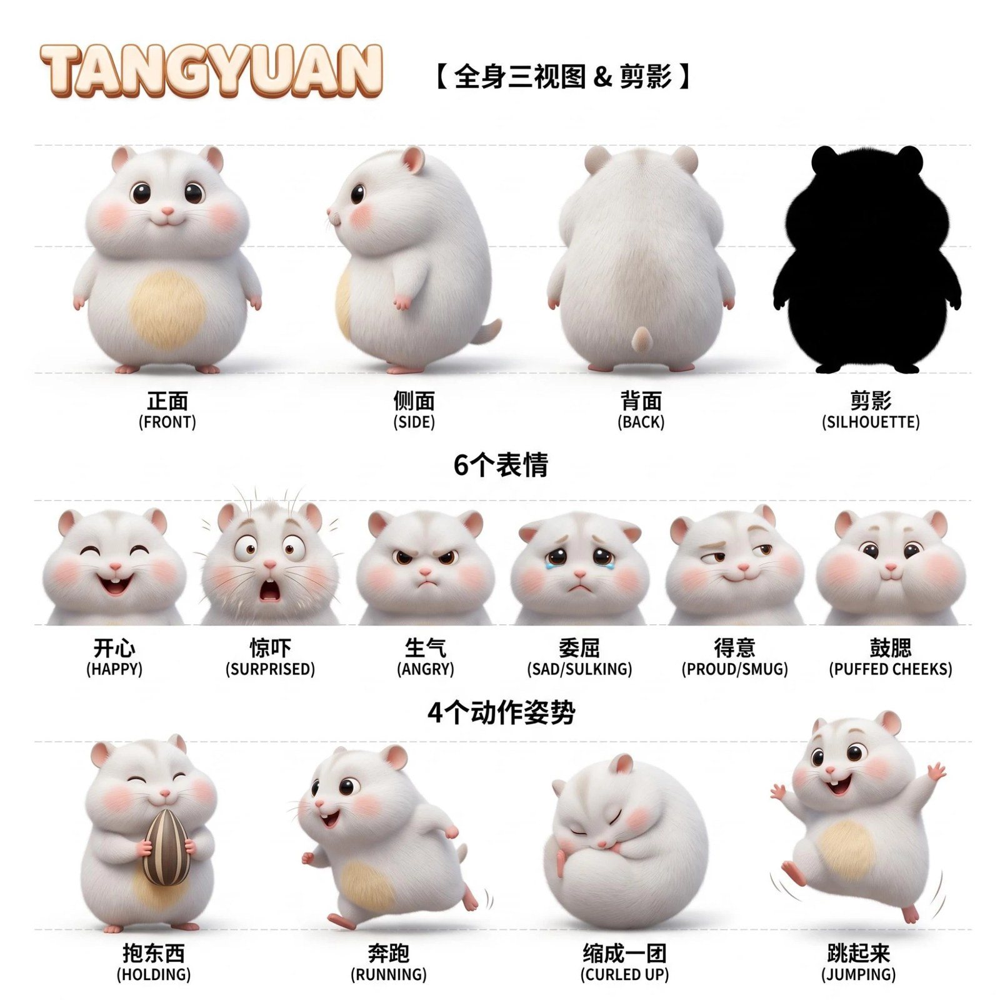
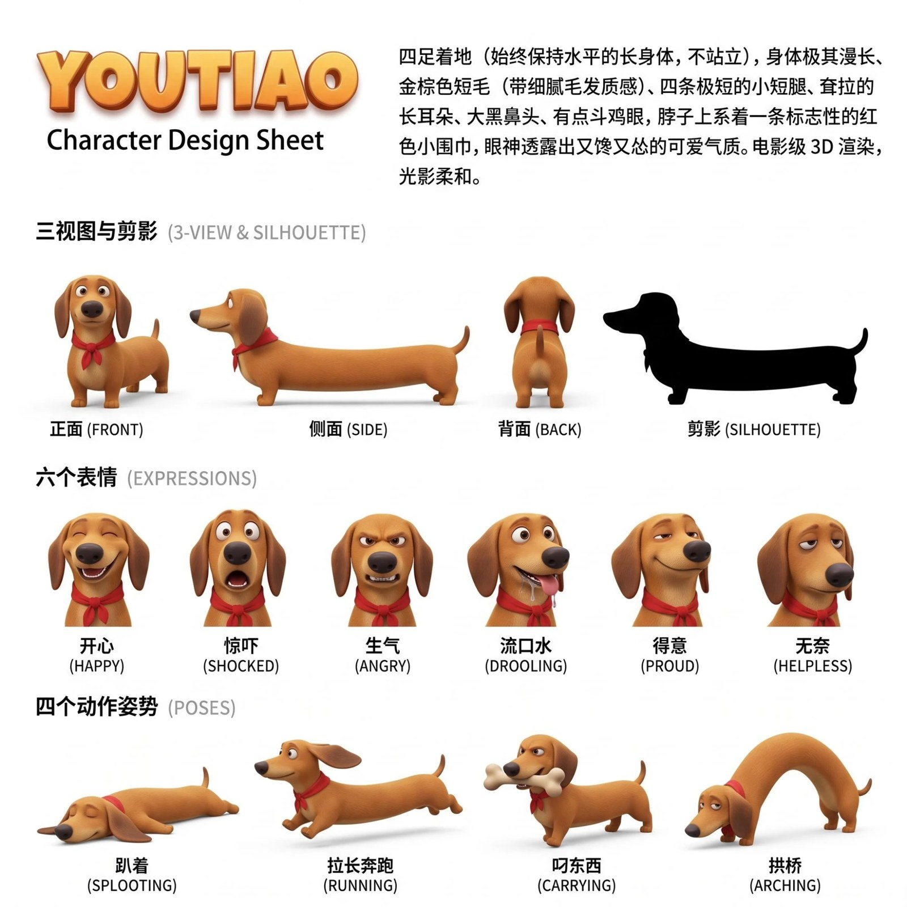
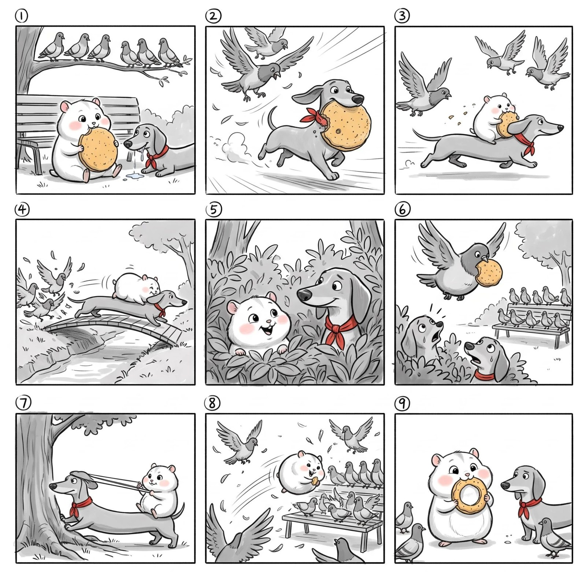
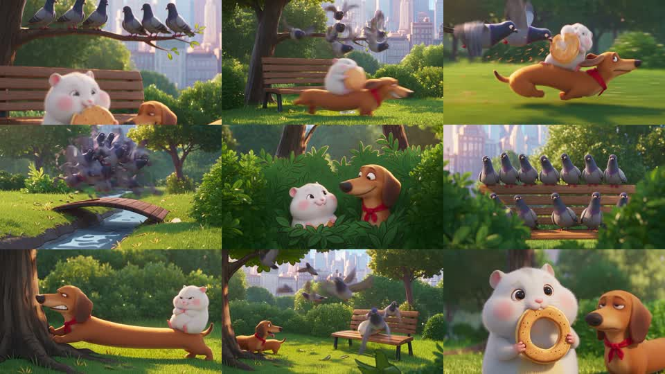

# AI 动画单元剧 · AI Anime Series

[中文](#中文) · [English](#english)

https://github.com/user-attachments/assets/3e79e4f6-5893-4660-870c-5d18d0f3dc05

汤圆和油条 第 1 集《抢煎饼》，30 秒，即梦 Seedance 2.5 一次生成（480p）。视频文件：[`assets/demo.mp4`](assets/demo.mp4)

---

## 中文

**汤圆和油条**：一只圆滚滚的白仓鼠，一条超长的腊肠狗，在公园里跟鸽子帮抢一块煎饼。油条把身子拉长当桥、拉成弹弓，汤圆缩成球当保龄球撞进鸽群，抢回来一看，煎饼只剩一个圈。30 秒，没有一句台词，一次生成。

这个仓库是做这种 **AI 动画单元剧** 的完整流程，免费开源：固定几个原创角色，以后每集说一句主题，就能出一集。

- **Claude Skill**：装进 [Claude Code](https://claude.com/claude-code) 后说「出一集汤圆和油条抢冰淇淋」，它写剧本、出提示词、检查成片
- **提示词自动拼**：出场角色几个、@图 编号就排几个；时长多长、宫格就几格；秒数自动对齐
- **真实用过的例子**：角色设定、故事板、视频提示词、成片
- **脚本**：拼宫格、抽帧检查、1 分钟两段拼接、换掉某一段、拼合集

### 做法：故事板直出

| | 是什么 | 在哪做 |
| --- | --- | --- |
| ① 角色设定图 | 每个角色一张：三视图 + 表情 + 动作 + 剪影 | 即梦画布 · 图片生成 |
| ② 宫格故事板 | 一张黑白素描分镜，30 秒 9 格 | 即梦画布 · 图片生成（框选设定图） |
| ③ 视频 | 设定图 + 故事板 + 按秒写的镜头和音效，一次出 30 秒 | 即梦画布 · Seedance 2.5 全能参考 |

| 汤圆 | 油条 | 故事板 |
| --- | --- | --- |
|  |  |  |

成片抽帧：



提示词：[`examples/tangyuan-youtiao/ep01/prompts/`](examples/tangyuan-youtiao/ep01/prompts/) · 设定：[`series.json`](examples/tangyuan-youtiao/series.json) · 镜头表：[`episode.json`](examples/tangyuan-youtiao/ep01/episode.json)

### 流程

| 步骤 | 做什么 | 谁来做 | 文档 |
|---|---|---|---|
| 1 | 立 IP：剪影差别大、每人一个招牌能力，出设定图 | Claude 写，你在即梦出图 | [01](docs/01-characters.md) |
| 2 | 写一集：开场 → 冲突 → 反转 → 反击 → 结尾笑点，先出镜头表 | Claude 写，你确认 | [02](docs/02-script.md) |
| 3 | 拼提示词：@图 编号、宫格、秒数自动对齐 | 脚本 | [03](docs/03-prompts.md) |
| 4 | 即梦画布：框选节点出故事板，再出视频（先 480p） | 你 | [04](docs/04-jimeng-canvas.md) |
| 5 | 检查成片、改单个情节、记录已拍、拼合集 | 脚本 + Claude | [05](docs/05-pitfalls.md) |

### 时长

| 时长 | 宫格 | 每格平均 |
| --- | --- | --- |
| 15 秒 | 6 格（2 行 3 列） | 2.5 秒 |
| 30 秒（默认） | 9 格（3 行 3 列） | 3.3 秒 |
| 1 分钟 | 上下两段各 9 格，拼起来 | 3.3 秒 |

### 你需要

- 即梦会员（画布 + Seedance 2.5）；海外用 Dreamina，提示词通用
- 跑脚本：Python 3.9+、ffmpeg、`pip install pillow`

### 安装成 Claude Skill

```bash
git clone https://github.com/10291124jcjc-dotcom/ai-anime-series.git ~/.claude/skills/ai-anime-series
```

Windows 上把 `~/.claude/skills` 换成 `%USERPROFILE%\.claude\skills`。然后在 Claude Code 里说：

> 我想做一个 AI 动画号，主角是一只胖猫和一只瘦老鼠，在菜市场

### 只用脚本

```bash
python scripts/setup_check.py my-series ep01            # 检查环境、建文件夹、复制模板
python scripts/make_prompts.py my-series sheets         # 角色 / 场景设定图提示词
python scripts/make_prompts.py my-series ep01           # 故事板 + 视频提示词
python scripts/make_prompts.py my-series ep01 panel 6   # 只重出故事板第 6 格
python scripts/make_prompts.py my-series ep01 patch 5-6 # 只补拍第 5–6 格
python scripts/review_clip.py my-series ep01            # 抽帧检查即梦生成的视频
python scripts/grid.py grid 故事板.png 01.png 02.png ...  # 单格拼回宫格
python scripts/compile.py concat 合集.mp4 ep01.mp4 ep02.mp4 --titles "第1集" "第2集"
```

### 注意

- 只做原创角色：不用真人，不照搬现有动漫或别人账号的角色
- 参考别人的号只学套路，不搬角色、不搬画面
- 配乐用即梦生成的，或者你自己有版权的
- 发布时标注 AI 生成

### 作者

硅基废话（X：[@DDJCXX](https://x.com/DDJCXX)）。做出来的视频欢迎 @ 我。

其他项目：[古人说唱 Battle](https://github.com/10291124jcjc-dotcom/ancient-rap-battle) · [埃及艳后的现代日常](https://github.com/10291124jcjc-dotcom/cleopatra-modern-life)

---

## English

**Tangyuan & Youtiao**: a round white hamster and an extra-long dachshund fight a pigeon gang over a pancake in the park. The dachshund stretches into a bridge and a slingshot, the hamster rolls into the pigeons like a bowling ball, and the pancake they win back is just a ring. 30 seconds, no dialogue, generated in one go.

This repo is the full workflow for a **recurring-character AI animated comedy series**: set up a few original characters once, then each episode starts from one sentence.

- **A Claude Skill**: install it in [Claude Code](https://claude.com/claude-code) and say "make an episode where Tangyuan and Youtiao steal an ice cream"
- **Prompts are assembled, not templated**: reference numbers follow who is in the episode, the grid follows the length, timings are checked
- **The real example**: character sheets, storyboard, prompts, final video
- **Scripts**: rebuild a storyboard grid, sample frames for review, join two halves of a 1-minute episode, swap out one segment, compile a season

**Method (storyboard-first)**: one design sheet per character → one black-and-white sketch storyboard grid (9 panels for 30 s) → Jimeng / Dreamina Seedance 2.5 omni-reference with the sheets + storyboard + a shot list timed to the second with sound cues. Make everything on the Jimeng canvas, render at 480p first.

**Install**

```bash
git clone https://github.com/10291124jcjc-dotcom/ai-anime-series.git ~/.claude/skills/ai-anime-series
```

**Rules**: original characters only (no real people, no existing cartoon or creator IP); generate or license your own music; label videos as AI-generated.

Code in `scripts/` is MIT; everything else is CC BY-NC 4.0. See [LICENSE](LICENSE).
